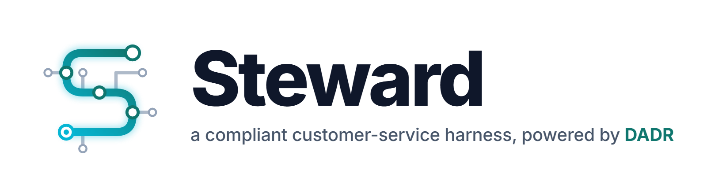
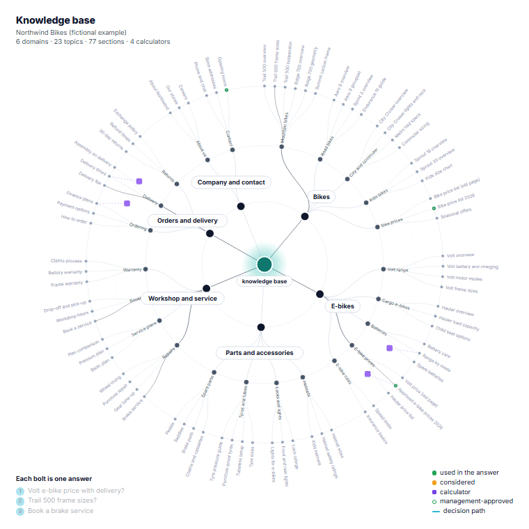

<p align="center">
  <picture>
    <source media="(prefers-color-scheme: dark)" srcset="assets/steward-logo-dark.png">
    
  </picture>
</p>

<p align="center">
  <a href="LICENSE"></a>
  
  
  
</p>

Steward turns a knowledge base and an admin-editable configuration into a customer-service assistant that you can embed in any Python system:

- **Answers only from your knowledge.** [DADR](#how-dadr-works) (dependency-aware decision retrieval) navigates a knowledge tree with a cheap decision model. Calculators do the arithmetic in code. Numbers in a reply are checked against the evidence. Management-approved information outranks other sources, and the outdated lines it contradicts are hidden.
- **Follows your rules.** Approved templates in several languages, required and forbidden wording, policies such as "never discuss X" or "always add Y", and no claim of an action that no tool actually performed.
- **Runs journeys.** Lead capture, human handover with an availability check, or any multi-step flow, drawn as a graph of cards in the admin page. A journey runs alongside the knowledge answer.
- **Calls your tools** as callbacks identified by a string id: your CRM, ticketing system or staffing system. Calls are idempotent and leave receipts.
- **Stores data where you want it.** Built-in stores are memory, SQLite, MongoDB and Firestore, or you can write your own adapter. Store contract test suites are included.
- **Is cheap, and you can see what it did.** Every reply carries a trace with every step, the mechanism used (code, decision or LLM), tokens and cost. A spend cap is enforced through a ledger.

<p align="center">
  <picture>
    <source media="(prefers-color-scheme: dark)" srcset="assets/architecture-dark.png">
    
  </picture>
  <br><sub>One turn: a linear spine with the knowledge engine in the middle; journeys and your tools run on the outer path.</sub>
</p>

## How DADR works

**DADR (dependency-aware decision retrieval)** is the knowledge engine inside Steward. It doesn't embed chunks and hope the nearest ones contain the answer. Instead, it lets a cheap *decision model* walk a knowledge tree with yes/no questions. It then follows the **dependencies** of what it picked, so the evidence is complete, and does every calculation in code.

<p align="center">
  <picture>
    <source media="(prefers-color-scheme: dark)" srcset="assets/dadr-dark.png">
    
  </picture>
</p>

The knowledge base is built once. It is a tree of domains → topics → section-sized units, plus the numeric values in them, entities, and **calculators** whose inputs are typed values. Each question then goes through four steps:

1. **Route** *(decision model)*. A keyword shortlist, then one batched decision call scores the topics, the shortlisted sections and the calculators. If the message has several questions, each part is routed in parallel.
2. **Select** *(decision model)*. Yes/no for each section inside the chosen topics, then a **gate**: is this enough to answer? If not, the engine expands once (the next topics and more keyword hits). If that still fails, it falls back to sections *about* the subject, so the answer can at least say what is known.
3. **Dependencies** *(code)*. This is what makes it *dependency-aware*. Picking something brings what it depends on:
    - a **calculator** brings the sections that hold its inputs, even from another domain;
    - an outdated **source** section brings the **management-approved** section that corrects it, and the contradicted lines are hidden;
    - every **entity** the question mentions must be covered by a selected section.
4. **Compute and verify** *(code + LLM)*. Calculators run in code (a safe expression evaluator, no `eval`). The LLM writes the reply from the selected evidence only, and every number in the reply must appear in the evidence or the calculations. If one doesn't, the reply is rewritten once. If it still fails, the customer gets the computed figures and the relevant section titles instead, never an unchecked number. When no evidence is found at all, the reply says so and offers the escalation contacts.

Why it works well for customer service:

- **Cheap.** Decision calls are short, batched and billed on input only, and repeated questions reuse a cached plan. A whole turn typically costs a fraction of a cent.
- **Auditable.** Every decision and score is in `reply.trace`, so you can see why a section was chosen.
- **No invented numbers.** Prices and totals come from the knowledge base and from code, never from the model's memory.
- **No vector index to keep in sync.** Re-building the tree after a content change is cached per section.

## Install

```bash
pip install steward-harness                 # core: pydantic + httpx
pip install "steward-harness[server]"       # + the admin page and API (FastAPI)
pip install "steward-harness[mongo]"        # + MongoDB stores
pip install "steward-harness[firestore]"    # + Firestore stores
```

Try it without any API key (a fictional bike shop, "Northwind Bikes", with scripted decisions):

```bash
steward demo          # admin page at http://127.0.0.1:8765/steward/admin
```

## Use

```python
from steward import Message, Steward, ToolCall, ok
from steward.knowledge import MemoryKnowledgeStore
from steward.providers import OpenRouter
from steward.stores.sqlite import SqliteStores

bot = Steward.from_file(
    "assistant.steward.json",                       # validated config (JSON Schema in schema/)
    provider=OpenRouter.from_env(spend_cap_usd=5),  # OPENROUTER_API_KEY
    stores=SqliteStores("assistant.db"),            # sessions, records, config versions, ledger, ...
    knowledge=MemoryKnowledgeStore.from_file("kb.json"),
)

@bot.tool("crm.save_lead")                          # a config tool instance with "impl": "crm.save_lead"
async def save_lead(call: ToolCall):
    ref = await crm.upsert(call.args["record"], key=call.idempotency_key)
    return ok({"id": ref}, receipt={"crm_id": ref})

bot.on("handover", lambda event, payload: notify_agents(payload))

bot.check()                                         # fail fast: invalid config, unregistered tools
reply = bot.handle(Message(session="user-42", text="How much is the Trail 500?"))   # sync hosts
reply = await bot.ahandle(Message(session="user-42", text="..."))                   # async hosts
print(reply.text, reply.status, reply.trace.totals.cost_usd)
```

`reply.status` is one of:
- `answered`, `needs_input`, `insufficient`, `chitchat`, `meta`;
- `template`, `handover`, `paused`;
- `error`, `budget_exceeded`.

`reply.trace.to_table()` shows each step.

## The configuration

One JSON file holds everything client-specific: profile, languages, templates, rules, policies, slots and validators, tools and journeys. The engine contains no client words. Admins edit a **draft** in the admin page, test it, and **publish** it. Every version is kept and can be restored.

- [docs/config-reference.md](docs/config-reference.md) is generated from the models.
- [schema/steward.schema.json](schema/steward.schema.json) gives editors and agents autocompletion and validation.
- [examples/northwind](examples/northwind/northwind.steward.json) is a complete example.
- `steward check FILE` validates a config and `steward migrate FILE` upgrades an older format.

## Knowledge

<p align="center">
  <picture>
    <source media="(prefers-color-scheme: dark)" srcset="assets/knowledge-strikes-dark.gif">
    
  </picture>
  <br><sub>Each bolt is one answer: the decision model routes root → domain → topic → section. Green: used, amber: considered, violet: calculators.
  Still versions: <a href="assets/knowledge-radial-light.png">light</a> · <a href="assets/knowledge-radial-dark.png">dark</a>.</sub>
</p>

A knowledge base is a `KnowledgeSnapshot`: a tree of domains and topics, section-sized units, typed numeric values, entities and calculators. You can:
- load it from JSON (`MemoryKnowledgeStore.from_file`);
- keep it in SQLite, MongoDB or Firestore;
- implement two async methods over your own database (see [examples/custom_knowledge_store.py](examples/custom_knowledge_store.py)).

To build one from markdown documents (optional, paid model calls, cached):

```bash
steward build pages/*.md --approved approved.md --description "Northwind Bikes, a bicycle shop" -o kb.json
```

## Admin page

```python
from steward.server import create_router
app.include_router(create_router(bot, auth=my_auth), prefix="/steward")   # FastAPI
```

The admin page has these parts:
- a journeys canvas;
- policies, rules and templates;
- the profile and a prompt preview;
- slots and tools;
- records (with CSV export);
- the agents-online switch;
- version history;
- a test chat that runs the draft.

Roles are viewer, editor and publisher. Without `auth`, the page is served only with `insecure_local=True` on localhost. See [examples/fastapi_app.py](examples/fastapi_app.py).

## Evaluate

```bash
steward eval assistant.steward.json scenarios.json --knowledge kb.json --record --calibrate
```

Scenarios are multi-turn conversations with expectations per turn (status, text, journeys, policies, tools, slots, pending asks, cost) plus invariants that apply to every reply. Model calls go to a cassette, so re-runs are free. `--calibrate` suggests trigger thresholds. See [docs/evals.md](docs/evals.md).

## Documentation

| | |
|---|---|
| [docs/concepts.md](docs/concepts.md) | The turn pipeline, journeys, policies, templates, rules, slots |
| [docs/tools.md](docs/tools.md) | Tool ids, `ToolCall`, results, receipts, idempotency, mock mode, built-ins |
| [docs/stores.md](docs/stores.md) | Store protocols, the adapters, writing your own, contract tests |
| [docs/providers.md](docs/providers.md) | OpenRouter, other providers, the decision emulator, spend caps, cassettes |
| [docs/server.md](docs/server.md) | The admin page and API, auth and roles |
| [docs/evals.md](docs/evals.md) | Scenario files, the runner, calibration |
| [docs/build.md](docs/build.md) | Building knowledge from documents, approved knowledge, supersede review |
| [AGENTS.md](AGENTS.md) | For coding agents: how to integrate and how to work on this repo |

## Development

```bash
uv sync --extra dev
uv run pytest          # no network, no keys; Firestore tests run when FIRESTORE_EMULATOR_HOST is set
uv run ruff check src tests && uv run pyright
```

The figures in this README are rendered with [Remotion](https://www.remotion.dev) from `figures/` (`cd figures && npm ci && node render.mjs`).

## License

Apache-2.0. See [LICENSE](LICENSE). The bundled Drawflow editor is MIT-licensed (`src/steward/server/static/vendor/DRAWFLOW_LICENSE`).
